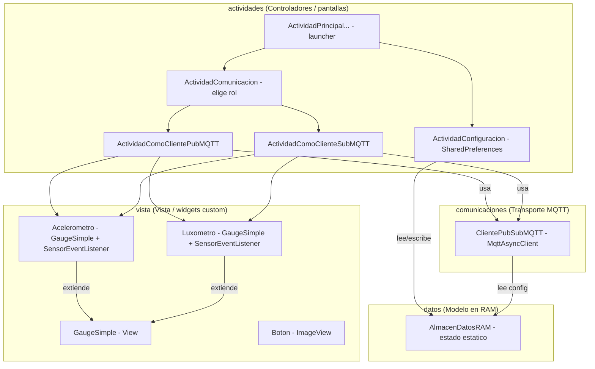
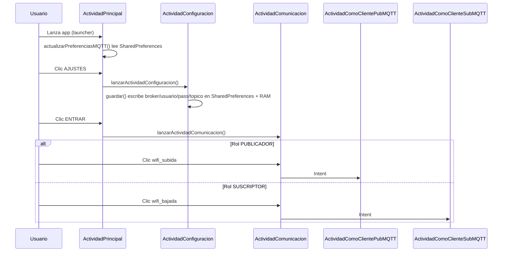
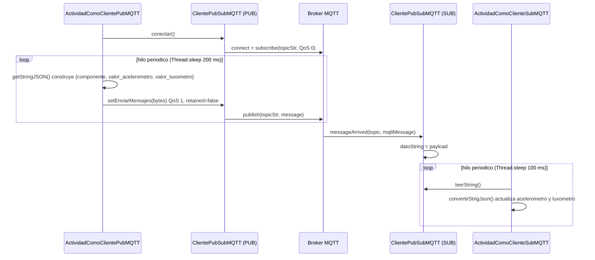

# Design Document

## Overview

Este diseño describe cómo ensamblar y depurar la aplicación Android `MiCuadragesimaPrimeraApp` definida por completo en el Módulo 15 (`modulo_15.md`). La app demuestra comunicación IoT con el patrón PUBLICADOR/SUSCRIPTOR sobre el protocolo MQTT: dos dispositivos Android ejecutan la misma app; uno actúa como PUB (publica lecturas de acelerómetro y luxómetro como JSON) y el otro como SUB (recibe esas lecturas y las muestra en tacómetros `GaugeSimple`).

Este es un trabajo de **ensamblado y depuración**, no de diseño de código nuevo. Todo el código fuente ya existe verbatim dentro de `modulo_15.md`. El Agente transcribe cada clase al paquete correcto en el orden correcto, copia las imágenes drawable requeridas, actualiza el manifiesto de Android y verifica la compilación después de cada paso.

Un build parcial de una sesión previa ya existe y DEBE preservarse. El objetivo del diseño es, por tanto, definir con precisión:

1. El orden de ensamblado de las clases pendientes y las verificaciones entre cada paso.
2. La reconciliación de `package`/`import` para el código crudo del markdown que no declara paquete.
3. La copia de los 11 drawables requeridos desde la carpeta de imágenes (solo lectura) hacia `res/drawable`.
4. La actualización del `AndroidManifest.xml`.
5. El mecanismo de verificación de build y el manejo de errores dentro del alcance definido.

### Alcance y contexto de ejecución

- **Working_Directory (única carpeta editable):** `c:\Users\PRODESK\OneDrive\Documentos\UNAL\SIMULACIONES\MiCuadragesimaPrimeraApp`
- **Images_Directory (solo lectura):** `c:\Users\PRODESK\OneDrive\Documentos\UNAL\SIMULACIONES\Images`
- **Module_Markdown (fuente de código):** `c:\Users\PRODESK\OneDrive\Documentos\UNAL\SIMULACIONES\md\modulo_15.md`
- **Namespace / applicationId:** `com.curso_simulaciones.micuadragesimaprimeraapp`
- **Java_Source_Root:** `app/src/main/java/com/curso_simulaciones/micuadragesimaprimeraapp`
- **Drawable_Directory:** `app/src/main/res/drawable`

### Estado actual verificado (preservar y continuar)

| Elemento | Estado |
|----------|--------|
| `settings.gradle.kts` con repo `jitpack.io` | Presente — preservar byte-a-byte |
| `app/build.gradle.kts` con `com.github.hannesa2:paho.mqtt.android:3.3.5` | Presente — preservar byte-a-byte |
| `datos/AlmacenDatosRAM.java` | Presente y verificada |
| `vista/Boton.java` | Presente y verificada |
| `vista/GaugeSimple.java` | Presente y verificada |
| `vista/Acelerometro.java` | Presente y verificada |
| `vista/Luxometro.java` | Presente y verificada |
| Carpetas de paquetes y `res/drawable` | Creadas |

### Trabajo pendiente

1. Crear `comunicaciones/ClientePubSubMQTT.java`.
2. Crear las 4 actividades secundarias en `actividades_secundarias`: `ActividadComunicacion`, `ActividadConfiguracion`, `ActividadComoClientePubMQTT`, `ActividadComoClienteSubMQTT`.
3. Crear la actividad raíz `ActividadPrincipalMiCuadragesimaPrimeraApp.java`.
4. Copiar los 11 drawables requeridos desde `Images` a `res/drawable`.
5. Actualizar `AndroidManifest.xml`.
6. Verificación de build final.

## Architecture

La aplicación sigue una arquitectura **MVC simple organizada por paquetes**, construida enteramente de forma programática (sin XML de layout; las GUI se arman con `LinearLayout` en código).



### Capas

- **datos (Modelo):** `AlmacenDatosRAM` mantiene estado en campos estáticos: dimensiones de resolución, parámetros MQTT (`MQTTHOST`, `USERNAME`, `PASSWORD`, `topicStr`), y estado de conexión (`conectado`, `conectado_PubSub`). Actúa como almacén compartido entre actividades y cliente MQTT.
- **vista (Vista):** Widgets dibujados en `Canvas`. `GaugeSimple` es el tacómetro base (`View` con `onDraw` que dibuja sectores, agujas, marcas y unidades). `Boton` es un `ImageView` custom que escala la imagen con `Matrix` y dibuja texto. `Acelerometro` y `Luxometro` extienden `GaugeSimple` e implementan `SensorEventListener` para leer sensores del hardware.
- **comunicaciones (Transporte):** `ClientePubSubMQTT` envuelve `MqttAsyncClient` de `org.eclipse.paho.client.mqttv3` (NO `MqttAndroidClient`). Implementa `MqttCallback` e `IMqttActionListener`. Lee la configuración del broker desde `AlmacenDatosRAM`.
- **actividades (Controlador):** La actividad raíz enruta a las pantallas secundarias. Las GUI se construyen programáticamente con `LinearLayout` anidados y parámetros de peso.

### Flujo de navegación



### Flujo de datos IoT (PUB/SUB)



## Components and Interfaces

A continuación se describe cada componente pendiente de crear y su interfaz. El código se transcribe **verbatim** del Module_Markdown; la única reconciliación permitida es la de `package`/`import` (ver "Reconciliación de paquetes e imports").

### ClientePubSubMQTT (paquete `comunicaciones`)

- **Rol:** Cliente MQTT pub/sub que usa `MqttAsyncClient`.
- **Implementa:** `MqttCallback`, `IMqttActionListener`.
- **Package declarado en el markdown:** `com.curso_simulaciones.micuadragesimaprimeraapp.comunicaciones` (esta clase SÍ trae `package` e `import` completos en la fuente).
- **Interfaz pública:**
  - `ClientePubSubMQTT(Activity actividad)` — lee `MQTTHOST`, `USERNAME`, `PASSWORD`, `topicStr` de `AlmacenDatosRAM`.
  - `conectar()` — crea cliente con `MemoryPersistence`, configura `MqttConnectOptions` (versión 3.1.1, usuario/clave, `cleanSession=true`, `automaticReconnect=true`, `keepAliveInterval=60`) y conecta.
  - `leerString()` — devuelve el último payload recibido como `String`.
  - `setEnviarMensajes(byte[])` — publica con QoS 1, `retained=false`.
  - `desconectar()` — desuscribe y desconecta.
  - Callbacks: `onSuccess` (suscribe a `topicStr` con QoS 0), `onFailure`, `connectionLost`, `messageArrived`, `deliveryComplete`.
- **Restricción crítica:** NO debe referenciar `MqttAndroidClient` (requisito 4.2).

### ActividadComunicacion (paquete `actividades_secundarias`)

- **Rol:** Pantalla de selección de rol (PUB o SUB).
- **Interfaz / comportamiento:** Dos `Boton` (`wifi_subida` → `lanzarActividadComoClientePubMQTT()`, `wifi_bajada` → `lanzarActividadComoClienteSubMQTT()`), fondo `modelo`.
- **Dependencias de import:** `vista.Boton`, `R.drawable.*`, y las actividades `ActividadComoClientePubMQTT` / `ActividadComoClienteSubMQTT` (mismo paquete).

### ActividadConfiguracion (paquete `actividades_secundarias`)

- **Rol:** Captura broker/usuario/contraseña/tópico y los persiste.
- **Comportamiento:** `guardar()` escribe en `AlmacenDatosRAM` y en `SharedPreferences("MisPreferencias")` con claves exactas `broker`, `usuario`, `pasword`, `topico`. No se agregan, quitan ni renombran claves (requisito 6.3 del documento de requisitos para la raíz; aplica igual el principio aquí).
- **Dependencias de import:** `datos.AlmacenDatosRAM`, widgets de Android (`EditText`, `TextView`, `Button`), `SharedPreferences`.

### ActividadComoClientePubMQTT (paquete `actividades_secundarias`)

- **Rol:** Pantalla PUBLICADOR. Implementa `Runnable`.
- **Comportamiento:** Crea acelerómetro (con botones `ax/ay/az/a` para elegir componente) y luxómetro, captura sensores, crea `ClientePubSubMQTT`. En el botón CONECTAR→EMPEZAR arranca un hilo que cada 200 ms llama `escribir()` (publica JSON) y `actualizarAviso()`.
- **JSON publicado:** `{"componente": int, "valor_acelerometro": float, "valor_luxometro": float}`.
- **Dependencias de import:** `vista.Boton`, `vista.Acelerometro`, `vista.Luxometro`, `comunicaciones.ClientePubSubMQTT`, `datos.AlmacenDatosRAM`, `org.json.JSONObject/JSONException`, `R`.

### ActividadComoClienteSubMQTT (paquete `actividades_secundarias`)

- **Rol:** Pantalla SUSCRIPTOR. Implementa `Runnable`.
- **Comportamiento:** Crea acelerómetro y luxómetro (sin captar sensores locales). En CONECTAR→EMPEZAR arranca un hilo que cada 100 ms llama `leer()` (toma `leerString()`, parsea JSON con `convertirStrigJson()`) y `actualizarAviso()`. Actualiza componente/medida del acelerómetro y escala/medida del luxómetro.
- **Dependencias de import:** `vista.Acelerometro`, `vista.Luxometro`, `comunicaciones.ClientePubSubMQTT`, `datos.AlmacenDatosRAM`, `org.json.*`, `android.os.Handler`.

### ActividadPrincipalMiCuadragesimaPrimeraApp (paquete raíz `com.curso_simulaciones.micuadragesimaprimeraapp`)

- **Rol:** Actividad launcher. Pantalla de entrada con botones `entrar`, `salir`, `configuracion`, fondo `comunicacion_iot`.
- **Comportamiento:**
  - `gestionarResolucion()` resuelve `ancho/alto/dimensionReferencia/tamanoLetraResolucionIncluida` y los guarda en `AlmacenDatosRAM`.
  - `actualizarPreferenciasMQTT()` lee `SharedPreferences("MisPreferencias")` claves `broker`, `usuario`, `pasword`, `topico`.
  - Eventos: ENTRAR → `ActividadComunicacion`; AJUSTES → `ActividadConfiguracion`; SALIR → `finish()`.
- **Dependencias de import clave:** `actividades_secundarias.ActividadComunicacion`, `actividades_secundarias.ActividadConfiguracion`, `vista.Boton`, `datos.AlmacenDatosRAM`, `R`.

### Reconciliación de paquetes e imports

El código crudo del markdown (salvo `ClientePubSubMQTT`, que trae `package` e `import` completos) NO declara `package` ni todos los `import`. El diseño establece esta estrategia determinista:

1. **Insertar el `package` correcto** como primera sentencia de cada archivo según su carpeta destino:
   - `comunicaciones/ClientePubSubMQTT.java` → `...micuadragesimaprimeraapp.comunicaciones`
   - Las 4 actividades secundarias → `...micuadragesimaprimeraapp.actividades_secundarias`
   - `ActividadPrincipal...` → `...micuadragesimaprimeraapp` (raíz)
2. **Agregar los `import` necesarios** para que cada símbolo referenciado resuelva (clases Android del framework, clases propias de `datos`/`vista`/`comunicaciones`/`actividades_secundarias`, `org.json.*`, `org.eclipse.paho.client.mqttv3.*` y la clase `R`). No se altera ninguna línea de lógica; solo se añade el bloque de `package`+`import`.
3. **Confirmar la resolución mediante Build_Verification** tras cada clase.

Esto respeta el requisito 9.3 (reproducir la lógica verbatim) al limitar la modificación exclusivamente al encabezado `package`/`import`, conforme a los requisitos 5.1, 5.3, 5.4 y 6.1.

## Data Models

### AlmacenDatosRAM (ya existente — referencia)

Estado estático compartido:

| Campo | Tipo | Uso |
|-------|------|-----|
| `ancho`, `alto`, `dimensionReferencia`, `tamanoLetraResolucionIncluida` | `int` | Independencia de resolución |
| `MQTTHOST`, `USERNAME`, `PASSWORD`, `topicStr` | `String` | Configuración MQTT |
| `conectado_PubSub` | `String` | Mensaje de estado para el aviso en pantalla |
| `conectado` | `boolean` | Bandera de conexión activa |

### Mensaje IoT (JSON sobre el tópico MQTT)

```json
{
  "componente": 1,
  "valor_acelerometro": 9.8,
  "valor_luxometro": 350.0
}
```

- `componente` (int): 1=ax, 2=ay, 3=az, 4=|a|.
- `valor_acelerometro` (float): medida actual del acelerómetro.
- `valor_luxometro` (float): medida actual del luxómetro.

El PUB serializa con `JSONObject.toString()` y publica los bytes; el SUB parsea con `new JSONObject(datoString)` y actualiza los tacómetros.

### Configuración persistente (SharedPreferences "MisPreferencias")

| Clave | Origen | Destino |
|-------|--------|---------|
| `broker` | `edit_text_broker` | `AlmacenDatosRAM.MQTTHOST` |
| `usuario` | `edit_text_usuario` | `AlmacenDatosRAM.USERNAME` |
| `pasword` | `edit_text_contrasena` | `AlmacenDatosRAM.PASSWORD` |
| `topico` | `edit_text_topico` | `AlmacenDatosRAM.topicStr` |

Las claves se mantienen exactamente como en el markdown (incluido `pasword` sin "s"), sin agregar/quitar/renombrar.

### Broker_Defaults (del módulo)

- BROKER: `tcp://45.56.74.248:1883`
- USERNAME: `fisica`
- PASSWORD: `iotfisica`
- TOPIC: definible por el usuario.

### Drawables requeridos

Los 11 archivos a copiar desde `Images` a `res/drawable` (nombre exacto referenciado por el código):

`wifi_subida.png`, `wifi_bajada.png`, `modelo.png`, `ax.png`, `ay.png`, `az.png`, `a.png`, `entrar.png`, `salir.png`, `configuracion.png`, `comunicacion_iot.png`.

Todos cumplen el constraint de nombre de recurso Android (`[a-z0-9_]`). El icono lanzador personal (`lanzador_15.png`) es tarea opcional posterior al ensamblado core.

## Error Handling

El manejo de errores sigue estrictamente los requisitos de reporte-y-detener, preservando archivos existentes hasta que el usuario decida.

| Condición | Acción de diseño | Requisito |
|-----------|------------------|-----------|
| Clase existente faltante | Detener ensamblado, reportar ruta de cada clase faltante, no crear pendientes | 1.5 |
| Clase existente inconsistente con el markdown | Detener, reportar clase y naturaleza de inconsistencia, preservar contenido | 1.6 |
| Fuente de una clase pendiente no localizable en el markdown | Reportar nombre, no transcribir, no iniciar ensamblado | 2.2, 4.5 |
| Paquete requerido ausente | Crear el directorio del paquete antes de transcribir | 2.4 |
| `res/drawable` ausente | Crear el directorio antes de copiar | 2.6 |
| Drawable fuente ausente en `Images` | Reportar nombre, no copiar, ofrecer al menos una opción de resolución | 2.7 |
| Nombre de drawable inválido (`[a-z0-9_]`) | Reportar y pedir decisión; no renombrar silenciosamente | 3.2 |
| Error de compilación en una clase | Reportar clase + error del compilador, proponer corrección, conservar la fuente | 4.6, 5.7, 6.5, 7.7 |
| Error persistente tras 3 intentos de corrección (MQTT) | Detener correcciones automáticas y reportar al usuario | 4.7 |
| JDK/Android SDK no configurado | Detener Build_Verification, reportar prerequisito faltante y que el estado del build no pudo determinarse | 8.2 |
| Build final con errores | Reportar cada clase/recurso que falla y su error, proponer correcciones, preservar archivos | 8.3 |
| Dependencia/recurso no nombrado en el markdown parece necesario | Detener la adición, reportar nombre y razón, pedir decisión explícita | 9.5 |
| Error irresoluble dentro del alcance | Reportar clase + descripción, presentar ≥1 solución candidata, no alterar archivos | 9.6 |

### Manejo de errores en tiempo de ejecución (código del módulo, verbatim)

- `ClientePubSubMQTT` captura `MqttException` en `conectar()`, `setEnviarMensajes()` y `desconectar()`, actualizando `AlmacenDatosRAM.conectado` y `conectado_PubSub`.
- El SUB envuelve el parseo JSON en `try/catch (JSONException)` para tolerar payloads vacíos o malformados sin romper el hilo.
- `setEnviarMensajes()` retorna temprano si el cliente es `null` o no está conectado.

### Consideraciones del entorno de edición (Windows)

El terminal del entorno (PSReadLine en PowerShell) es problemático para escribir archivos largos vía comandos de shell. **Decisión de diseño:** toda la creación y edición de archivos de código y manifiesto se realiza con las herramientas dedicadas de edición de archivos (no con `echo`/here-strings/redirecciones de terminal). El terminal se reserva exclusivamente para la ejecución del build (`gradlew`) y comprobaciones de prerequisitos. La copia de drawables se hace con operaciones de archivo, dejando `Images` intacta (solo lectura, requisito 9.2).

## Testing Strategy

### Aplicabilidad de Property-Based Testing (PBT)

**PBT NO es apropiado para esta feature y por eso se omite la sección "Correctness Properties".**

Razones:

1. **No es diseño de lógica nueva, es transcripción verbatim.** La correctitud esperada es la identidad byte-a-byte con el Module_Markdown (salvo encabezados `package`/`import`), no un comportamiento funcional nuevo que generalizar con "para todo input X".
2. **El código es UI renderizada y efectos de I/O.** Las clases son actividades Android (GUI construida con `LinearLayout`), widgets dibujados en `Canvas` (`GaugeSimple`, `Boton`), lectores de sensores (`SensorEventListener`) y un cliente de red MQTT. Según la guía del workflow, UI rendering, operaciones con solo efectos secundarios y dependencias externas (red/sensores/broker) NO son candidatos a PBT.
3. **No hay funciones puras con propiedades universales relevantes.** El único punto cercano (round-trip JSON) corresponde a `org.json`, biblioteca de terceros ya probada por sus autores; probarla no agregaría valor.

Por tanto, la estrategia de verificación se basa en **compilación incremental (Build_Verification) + verificación de recursos + prueba manual de integración en dispositivos**, que es lo que exigen los requisitos (R4–R8).

### Estrategia de verificación (orden de ensamblado)

El Agente transcribe y verifica incrementalmente. Tras cada clase se ejecuta Build_Verification antes de crear la siguiente (requisitos 4.4, 5.6, 6.4, 7.6):

1. **Prechequeo (R1, R2):** Confirmar presencia e integridad de las 5 clases existentes; confirmar que `settings.gradle.kts` y `app/build.gradle.kts` conservan jitpack y la dependencia Paho; verificar/crear paquetes y `res/drawable`; localizar en el markdown la fuente de cada clase pendiente.
2. **Copiar drawables (R3):** Copiar los 11 PNG desde `Images` a `res/drawable`; confirmar que cada nombre referenciado resuelve a exactamente un archivo.
3. **`comunicaciones/ClientePubSubMQTT.java` (R4):** Transcribir verbatim → Build_Verification.
4. **Actividades secundarias (R5):** En el orden de aparición en el markdown — `ActividadComunicacion`, `ActividadConfiguracion`, `ActividadComoClientePubMQTT`, `ActividadComoClienteSubMQTT` — reconciliando `package`/`import`; Build_Verification tras cada una.
5. **`ActividadPrincipalMiCuadragesimaPrimeraApp.java` (R6):** Transcribir con imports a `actividades_secundarias` → Build_Verification.
6. **Actualizar `AndroidManifest.xml` (R7):** Launcher + 4 actividades bajo `.actividades_secundarias`, tema `NoTitleBar.Fullscreen`, orientación `portrait`, 4 permisos sin duplicados, omitir `package` del root (namespace vive en Gradle) → Build_Verification.
7. **Build final (R8):** Ejecutar `gradlew` para todo el proyecto; reportar éxito (exit 0) o detallar fallos; limpiar temporales creados durante la verificación.

### Pruebas unitarias / de integración

- **Unit tests automatizados:** No se introducen clases de test nuevas, ya que el alcance prohíbe agregar código no nombrado en el markdown (requisito 9.4). La verificación de código es la compilación.
- **Smoke / configuración:** El build mismo (compilación + empaquetado APK) actúa como smoke test del ensamblado.
- **Integración manual (definida por el módulo):** Instalar el APK en dos dispositivos Android; uno como PUB y otro como SUB con el mismo tópico; verificar que las medidas del PUB (acelerómetro/luxómetro) aparecen en los tacómetros del SUB. Esta prueba end-to-end depende del broker, la red y hardware real, por lo que es manual (1 escenario representativo).

### Build_Verification — definición

- **Comando:** Gradle wrapper del proyecto (`gradlew`) para compilar el proyecto completo.
- **Prerequisitos:** JDK y Android SDK configurados. Si falta alguno, se detiene y se reporta cuál, indicando que el estado del build no pudo determinarse (requisito 8.2).
- **Criterio de éxito:** exit code 0 sin errores reportados (requisito 8.4).
- **Limpieza:** eliminar cualquier archivo temporal creado durante la verificación (requisito 8.5).

## Trazabilidad de requisitos

| Componente / decisión de diseño | Requisitos cubiertos |
|---------------------------------|----------------------|
| Preservación de Gradle y clases existentes; prechequeo de integridad | R1 (1.1–1.6) |
| Verificación de fuente en markdown y estructura de paquetes/carpetas antes de ensamblar | R2 (2.1–2.7) |
| Copia de los 11 drawables, validación de nombres, `Images` solo lectura, icono lanzador opcional | R3 (3.1–3.6) |
| `ClientePubSubMQTT` con `MqttAsyncClient`, lectura de `AlmacenDatosRAM`, build tras transcribir | R4 (4.1–4.7) |
| Cuatro actividades secundarias en `actividades_secundarias`, reconciliación `package`/`import`, orden y build incremental | R5 (5.1–5.7) |
| Actividad raíz launcher, imports a secundarias, resolución + SharedPreferences, build | R6 (6.1–6.5) |
| Manifiesto: launcher, actividades `.actividades_secundarias`, tema/orientación, 4 permisos, omitir `package` root | R7 (7.1–7.7) |
| Build final con `gradlew`, manejo de prerequisitos, reporte y limpieza | R8 (8.1–8.5) |
| Escritura restringida al Working_Directory, `Images` solo lectura, transcripción verbatim, sin dependencias extra, reporte con soluciones | R9 (9.1–9.6) |
